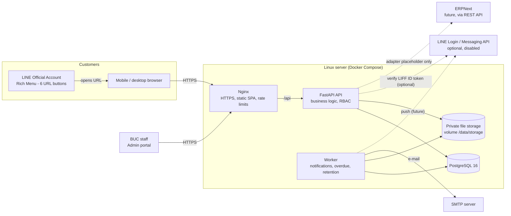
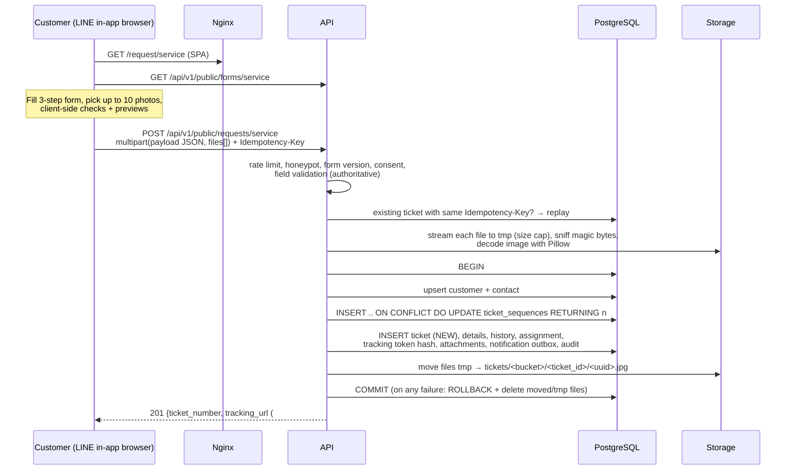
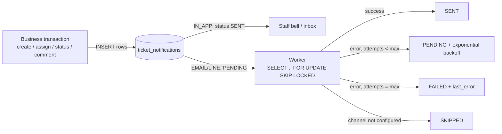

# System Architecture — BUC Customer Service & Ticket Management

## 1. Context



The system is **standalone**. ERPNext is not required at runtime; the ERPNext adapter is a
placeholder that refuses calls (see [ERPNEXT_INTEGRATION.md](ERPNEXT_INTEGRATION.md)).

## 2. Containers

| Container | Image | Role |
|-----------|-------|------|
| `web` | `nginx:1.27-alpine` + built SPA | TLS termination, security headers, CSP, request-rate limits, serves the React build, proxies `/api` |
| `api` | `python:3.12-slim` + FastAPI | REST API; runs Alembic migrations + idempotent seed on start |
| `worker` | same image as `api` | Delivers queued e-mail/LINE notifications, flags overdue tickets, applies retention |
| `db` | `postgres:16-alpine` | System of record |
| `mailpit` (optional profile) | `axllent/mailpit` | Local SMTP catcher for testing |

Persistent volumes: `pgdata` (database), `storage` (attachments, never served directly by Nginx).

## 3. Technology versions

| Layer | Technology | Version |
|-------|-----------|---------|
| Backend runtime | Python | 3.12 (container), tested on 3.13 |
| Web framework | FastAPI / Starlette | 0.162.0 / 1.10.0 |
| ASGI server | Uvicorn | 0.54.0 |
| ORM / migrations | SQLAlchemy / Alembic | 2.0.55 / 1.20.1 |
| Validation | Pydantic / pydantic-settings | 2.14.2 / 2.16.2 |
| DB driver | psycopg (binary) | 3.3.6 |
| Password hashing | argon2-cffi (Argon2id) | 25.1.0 |
| Image validation | Pillow | 12.3.0 |
| Database | PostgreSQL | 16 |
| Frontend | React / React Router / TypeScript | 19.2.9 / 7.18.5 / 5.9.3 |
| Frontend build & styling | Vite / @vitejs/plugin-react / Tailwind CSS (+ @tailwindcss/vite) | 7.3.7 / 5.2.0 / 4.1.18 |
| Charts | Recharts | 3.6.0 |
| Node.js (build image) | node:22-alpine | 22 |
| Reverse proxy | Nginx | 1.27 |

## 4. Backend layering

```
backend/app
├── main.py              FastAPI app, middleware (security headers, body limit), error handlers
├── config.py            Environment-based settings (BUC_*), production safety checks
├── db.py                Engine + session-per-request
├── models/              SQLAlchemy models (persistence layer)
├── schemas/             Pydantic request/response models
├── api/
│   ├── deps.py          Authentication, CSRF, role dependencies
│   └── routes/          public, auth, tickets, reports, notifications, lookups, admin
├── services/            Business logic (no HTTP knowledge)
│   ├── form_engine.py       versioned dynamic forms + validation
│   ├── files.py             upload validation & private storage
│   ├── ticket_numbers.py    atomic numbering
│   ├── ticket_service.py    submission, comments, customer replies, staff uploads
│   ├── workflow.py          configurable status transitions
│   ├── assignment.py        manual/auto assignment, transfers
│   ├── tracking.py          customer credentials + customer-safe view
│   ├── notifications.py     transactional outbox writers
│   ├── reports.py           dashboard & report calculations
│   └── settings_service.py  runtime settings with defaults
├── security/            passwords, sessions, tokens, permissions (RBAC), rate limiting
├── integrations/        email_smtp, line (LIFF verify, Messaging push), erpnext (interfaces + placeholder)
├── worker.py            background jobs
├── seed.py              reference data (departments, request types, 6 forms, statuses, workflow)
└── cli.py               seed / create-admin / sample data / OpenAPI export
```

Routes are thin: they authenticate, load the ticket with an authorisation check and call a service.
Services raise domain errors (`services/errors.py`) that the API maps to a uniform error body:

```json
{ "detail": { "code": "VALIDATION_ERROR", "message": "…", "fields": { "phone": "…" } } }
```

## 5. Key flows

### 5.1 Customer submission (Service Request with images)



* **All-or-nothing:** files are validated before the transaction; files moved during the
  transaction are deleted if the commit fails, so no orphan ticket or orphan file is left.
* **Idempotency:** the client generates one key per form session. A retry/double-tap returns the
  same ticket (HTTP 200, `replayed: true`). Two concurrent requests with the same key race on the
  `tickets.idempotency_key` UNIQUE constraint; the loser rolls back and replays the winner.
  Reusing a key with different data returns 409.
* **Tracking token** = HMAC(secret, idempotency key) so a replay can return the same token without
  storing it; only its SHA-256 hash is stored. It travels in the URL **fragment** (`#t=`), which
  browsers never send to servers or put in logs.

### 5.2 Notifications (transactional outbox)



Delivery never runs inside the business transaction, so an SMTP/LINE outage cannot roll back a
ticket. Failed rows are visible (and retryable) in **Admin → Notification logs**.

### 5.3 Authorisation model

Enforced server-side in `security/permissions.py` on every request; the UI only mirrors it.

| Capability | ADMIN | MANAGER | STAFF |
|-----------|-------|---------|-------|
| See tickets | all | own departments + assigned to them | assigned to them (+ own departments' queue when setting `access.staff_see_department_queue` is on — default) |
| Change status | all | own departments | tickets assigned to them |
| Assign staff / priority / due date | all | own departments | take an unassigned ticket of own department |
| Transfer department | all | own departments | tickets of own departments / assigned |
| Bulk assign, CSV export, reports | yes | yes (scoped) | no (scoped dashboard only) |
| Administration | yes | no | no |
| Workflow transition | per `workflow_transitions.allowed_roles` | | |

Tickets outside the caller's scope return **404** (not 403) so IDs cannot be probed.
Customers never authenticate as users: they access one ticket with *ticket number + tracking
token*; the public view contains no internal notes, assignment data or staff identities.

## 6. Design decisions

| Decision | Reason |
|----------|--------|
| Server-side sessions (httpOnly, SameSite=Lax cookie) + CSRF header instead of JWT in localStorage | Revocable (logout, deactivation, password reset), not readable by XSS, idle + absolute timeout |
| PostgreSQL table as job queue (outbox) instead of Redis/Celery | Fewer moving parts; atomic with business data; enough for the expected volume |
| Versioned form definitions | Forms can change without breaking historical tickets (tickets reference the exact version) |
| Customer/contact data normalised, form-specific data in `ticket_details` rows | Avoids duplicating master data; request data stays queryable (e.g. search by serial number) |
| Statuses and transitions in tables | Workflow is configurable without code changes |
| Integration mapping/log tables from day one | ERPNext can be connected later without schema redesign |
| Times stored as `timestamptz` (UTC), displayed in Asia/Bangkok | Unambiguous storage; ticket-number year and monthly reports use Bangkok calendar |
