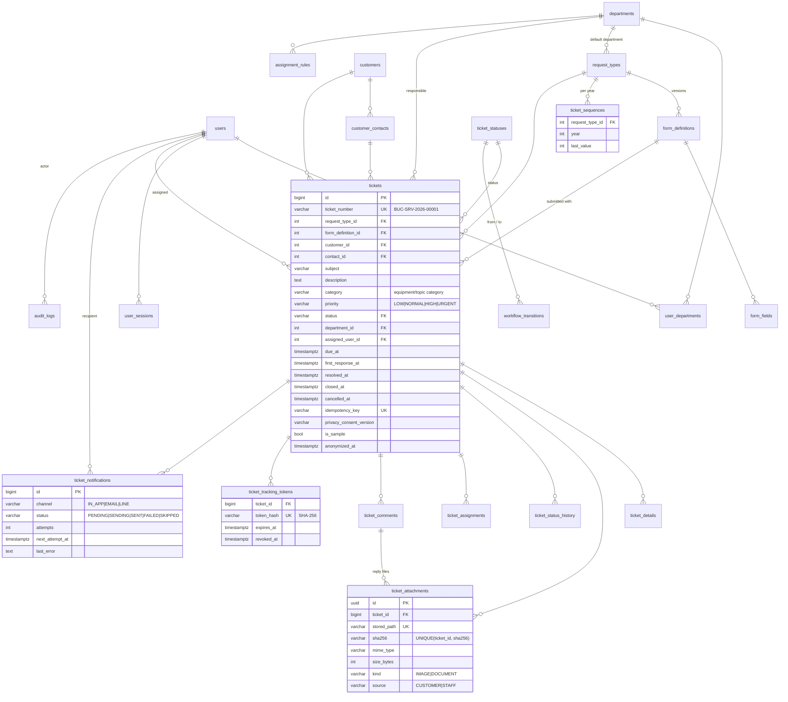

# Database Design (PostgreSQL 16)

Schema is managed by Alembic (`backend/alembic/versions`). All timestamps are `timestamptz`
stored in UTC. Constraint names follow a fixed naming convention (see `models/base.py`).

## ERD



## Tables

| Table | Purpose | Key constraints / indexes |
|-------|---------|---------------------------|
| `customers` | Customer master (hospital / company / agency) | `normalized_name` UNIQUE (dedup of portal submissions), `code` UNIQUE, type CHECK |
| `customer_contacts` | Contact persons of a customer | UNIQUE(`customer_id`, `match_key` = name+phone digits); `line_user_id` index (verified LIFF only) |
| `departments` | Organisation units (Sales, Logistics, Service, Accounting, Customer Service) | `code` UNIQUE |
| `users` | Staff accounts (Argon2id hashes, lockout fields) | `username`, `email` UNIQUE; role CHECK |
| `user_departments` | Staff ↔ department membership (authorisation scope) | composite PK |
| `user_sessions` | Server-side sessions (SHA-256 of cookie token, CSRF token, expiry) | `token_hash` UNIQUE |
| `request_types` | The six request categories, ticket prefix, default department/priority | `code`, `slug`, `ticket_prefix` UNIQUE |
| `form_definitions` | Versioned forms per request type, subject template | UNIQUE(`request_type_id`, `version`); partial UNIQUE: one active form per type |
| `form_fields` | Fields of a form version (type, validation JSON, options, `maps_to`) | UNIQUE(`form_definition_id`, `key`) |
| `ticket_statuses` | Status codes, Thai/English names, category used by reports | PK `code`; category CHECK |
| `workflow_transitions` | Allowed transitions + roles + comment requirement | UNIQUE(`from_status`, `to_status`) |
| `assignment_rules` | Automatic assignment rules (type/category/customer type/priority → dept/user) | — |
| `tickets` | Ticket header | see ERD; indexes on status+department, created_at, due_at, assignee, customer |
| `ticket_details` | Form-specific values (one row per field, label snapshot) | UNIQUE(`ticket_id`, `field_key`) |
| `ticket_attachments` | File metadata; files live in private storage | UNIQUE(`ticket_id`, `sha256`) prevents duplicate files; `stored_path` UNIQUE |
| `ticket_status_history` | Every status change: from, to, by, when, reason | index (`ticket_id`, `created_at`) |
| `ticket_assignments` | Assignment/transfer history (INITIAL, AUTO, MANUAL, SELF, TRANSFER) | index (`ticket_id`, `created_at`) |
| `ticket_comments` | INTERNAL notes and PUBLIC (customer-visible) updates, incl. customer replies | visibility CHECK |
| `ticket_tracking_tokens` | Hashes of customer tracking credentials; revocable | `token_hash` UNIQUE |
| `ticket_notifications` | Notification outbox + in-app inbox + delivery log | index (`status`, `next_attempt_at`), (`recipient_user_id`, `channel`, `read_at`) |
| `ticket_sequences` | Atomic per-type, per-year counters | UNIQUE(`request_type_id`, `year`) |
| `audit_logs` | Security/operational audit trail | index on `created_at`, (`entity_type`, `entity_id`) |
| `system_settings` | Runtime settings (JSONB) overriding code defaults | PK `key` |
| `integration_mappings` | Local record ↔ external (ERPNext) document | UNIQUE(`system`, `local_entity_type`, `local_id`, `external_doctype`) |
| `integration_logs` | Integration call log | index on `created_at` |

## Where form data is stored

| Form field `maps_to` | Stored in |
|----------------------|-----------|
| `customer.name`, `customer.customer_type` | `customers` (matched by normalised name) |
| `contact.name`, `contact.department`, `contact.phone`, `contact.email` | `customer_contacts` (matched by name + phone) |
| `ticket.description` | `tickets.description` |
| `ticket.priority` | `tickets.priority` (+ label kept in `ticket_details`) |
| `ticket.category` | `tickets.category` (+ label kept in `ticket_details`) |
| `ticket.attachments` | `ticket_attachments` |
| *(no mapping)* | `ticket_details` |

## Ticket numbering

`BUC-{PREFIX}-{YYYY}-{NNNNN}` where PREFIX ∈ PRD, DLV, SRV, QUO, ACC, GEN and YYYY is the
Gregorian year in Asia/Bangkok. The counter is advanced with one atomic statement:

```sql
INSERT INTO ticket_sequences (request_type_id, year, last_value) VALUES (:type, :year, 1)
ON CONFLICT ON CONSTRAINT uq_ticket_sequences_type_year
DO UPDATE SET last_value = ticket_sequences.last_value + 1, updated_at = now()
RETURNING last_value;
```

The row lock serialises concurrent submissions; the value is consumed only if the ticket
transaction commits; counters never decrease, so numbers are never reused after cancellation
or deletion. `tickets.ticket_number` is UNIQUE as a second safeguard. Verified by
`tests/test_ticket_numbers.py` (40 concurrent allocations, 16 concurrent full submissions).

## Migrations

```bash
cd backend
alembic upgrade head          # apply
alembic downgrade -1          # roll back one revision
alembic revision --autogenerate -m "describe change"   # new revision (review before committing)
```

The API container applies migrations automatically at start-up (`BUC_RUN_MIGRATIONS=1`).
