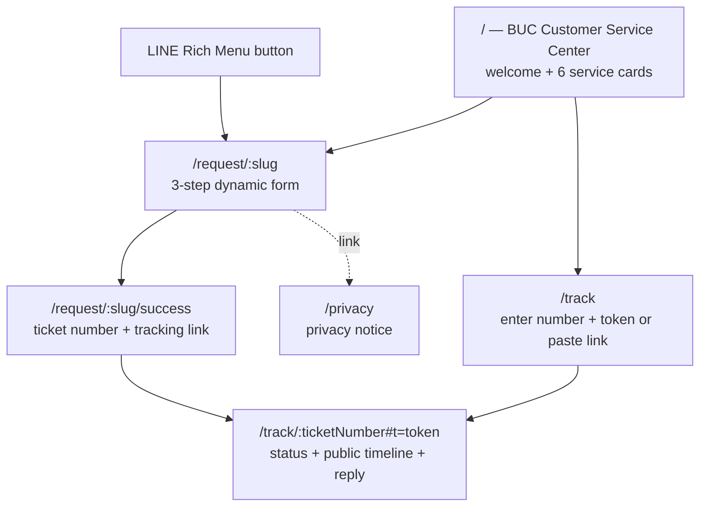

# UI Structure

React single-page application (`frontend/`). Thai is the default language, with an English toggle
(saved per browser). All dates are shown in Asia/Bangkok time. Brand palette: navy / corporate
blue / white / light gray.

The admin portal is lazy-loaded, so customers on mobile/LINE only download the portal bundle
(≈ 93 KB gzipped JS).

## Customer portal (mobile-first, works in the LINE in-app browser)



| Route | Screen | Notes |
|-------|--------|-------|
| `/` | Home | Header "BUC Customer Service Center", welcome message (from settings), six large category cards (same order as the Rich Menu), tracking link, contact info |
| `/request/:slug` | Request form | Steps: 1 ข้อมูลผู้ติดต่อ → 2 รายละเอียดคำขอ → 3 ตรวจสอบและส่ง. Rendered from the form definition API; per-step validation mirroring the server; review summary with thumbnails; privacy consent; submit with upload progress; one Idempotency-Key per form session |
| `/request/:slug/success` | Confirmation | Big ticket number, copy buttons, tracking link (keep-it-private note), "track now" |
| `/track` | Track (manual) | Ticket number + token, or paste the full tracking link |
| `/track/:ticketNumber` | Ticket status | Token read from `#t=`; status badge, request type, created date, timeline (status changes, "เจ้าหน้าที่ BUC" messages, customer messages); reply box with files while the ticket is open |
| `/privacy` | Privacy notice | Text + version from settings |

### Image upload component (`components/FileUploader.tsx`)

* Title from the form field, button **📷 เพิ่มรูปภาพ (n/10)**, text "แนบรูปภาพได้สูงสุด 10 ภาพ", help text.
* Two inputs: **camera** (`capture="environment"`) and **gallery** (multi-select).
* Thumbnails with remove and replace buttons; PDF tiles for document forms.
* Client checks: type (MIME + magic bytes), ≤ 10 MB, count ≤ limit. Selecting more than the limit
  keeps files up to the limit and shows a warning that the excess was not added.
* HEIC/HEIF photos are converted to JPEG in the browser when the browser can decode them.
* Identical files are de-duplicated.

## Staff / admin portal (desktop-optimised, responsive)

Layout: collapsible navy sidebar, top bar with language toggle, notification bell (polls unread
count every 60 s), user menu (change password, logout).

| Route | Screen | Visible to |
|-------|--------|-----------|
| `/admin/login` | Login | — |
| `/admin/change-password` | Change password (forced for temporary passwords) | all |
| `/admin` | Dashboard: filters, sample-data banner, 8 KPI cards (click → filtered list), charts (volume by month, by request type, by department, by status, average resolution time) | all (scoped) |
| `/admin/tickets` | Ticket list: search, filters, sortable columns (number, created, customer, type, subject, priority, status, department, assignee, last update), pagination, overdue highlight, sample badge, bulk assign, CSV export | all; bulk/CSV for ADMIN/MANAGER |
| `/admin/tickets/:id` | Ticket detail: A info, B customer, C assignment, D timeline (history + assignments + comments; internal notes marked "บันทึกภายใน (ลูกค้าไม่เห็น)"), E comment box (internal / customer update), F attachments gallery + full-screen viewer + upload, G actions (assign/take/transfer/status/request info/resolve/close/new tracking link) | all (per permissions) |
| `/admin/reports` | Summary / staff workload / performance tabs, calculation definitions, CSV | ADMIN/MANAGER |
| `/admin/notifications` | In-app notification inbox | all |
| `/admin/users` | Users: create (temporary password shown once), edit role/departments/status, reset password | ADMIN |
| `/admin/departments` | Departments | ADMIN |
| `/admin/request-types` | Request types (default department/priority/active, LINE Rich Menu URL), form field viewer, publish new form version (JSON) | ADMIN |
| `/admin/workflow` | Status names/colours, transition matrix (roles, comment required) | ADMIN |
| `/admin/assignment-rules` | Automatic assignment rules + on/off switch | ADMIN |
| `/admin/settings` | Typed settings editor (portal texts, privacy, retention, service targets, notifications) | ADMIN |
| `/admin/customers` | Customer master + contacts | ADMIN |
| `/admin/integrations` | LINE Rich Menu URLs, SMTP/LIFF/Messaging status, ERPNext status, mappings, integration logs | ADMIN |
| `/admin/notification-logs` | E-mail/LINE delivery log with retry | ADMIN |
| `/admin/audit-logs` | Audit trail with filters | ADMIN |

Navigation is hidden for screens the user's role cannot use; the server enforces the same rules.

## Source layout

```
frontend/src
├── api/          fetch client (CSRF header, uniform errors, XHR upload with progress), API types
├── i18n/         Thai/English dictionary + provider
├── lib/          dates (Asia/Bangkok), validation (mirrors backend rules), files (checks, HEIC→JPEG)
├── components/   UI primitives, icons, toasts, FileUploader
├── portal/       customer pages
└── admin/        staff pages (+ pages/ for administration screens)
```
